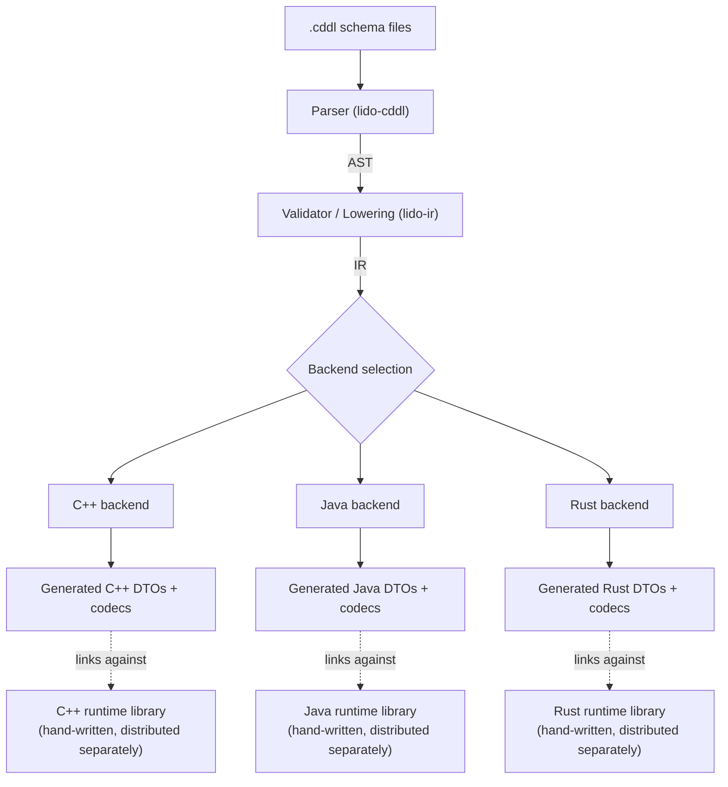
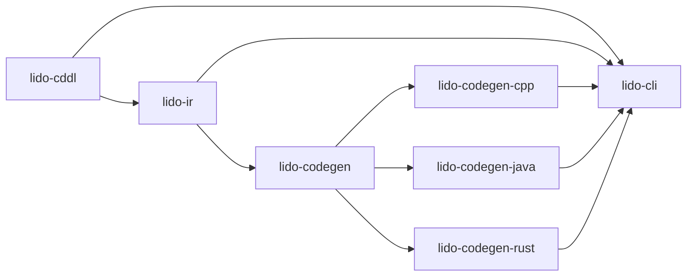
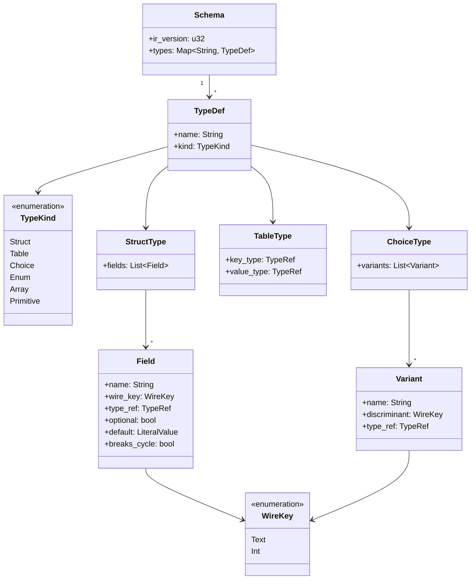
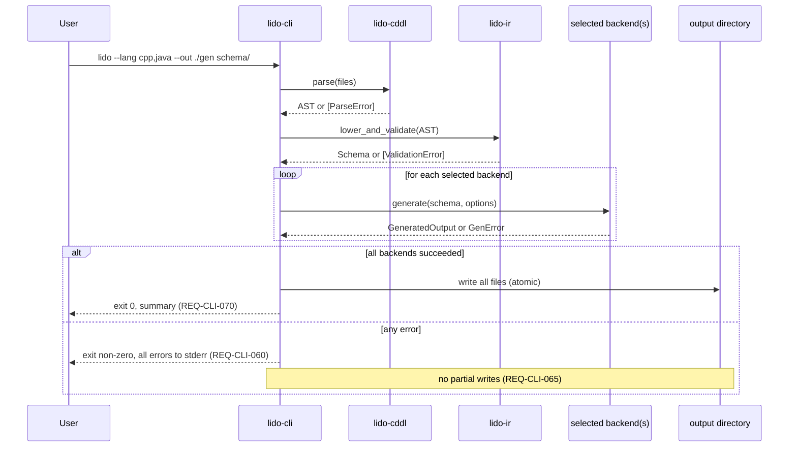
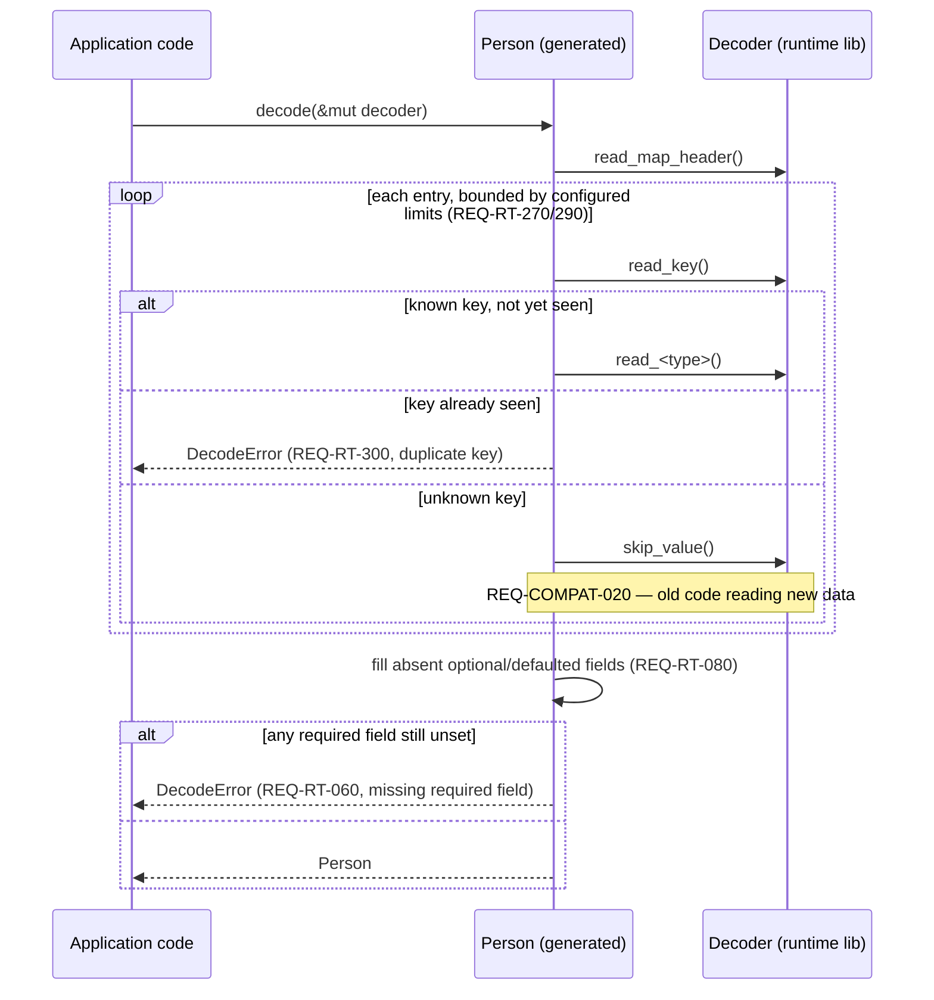
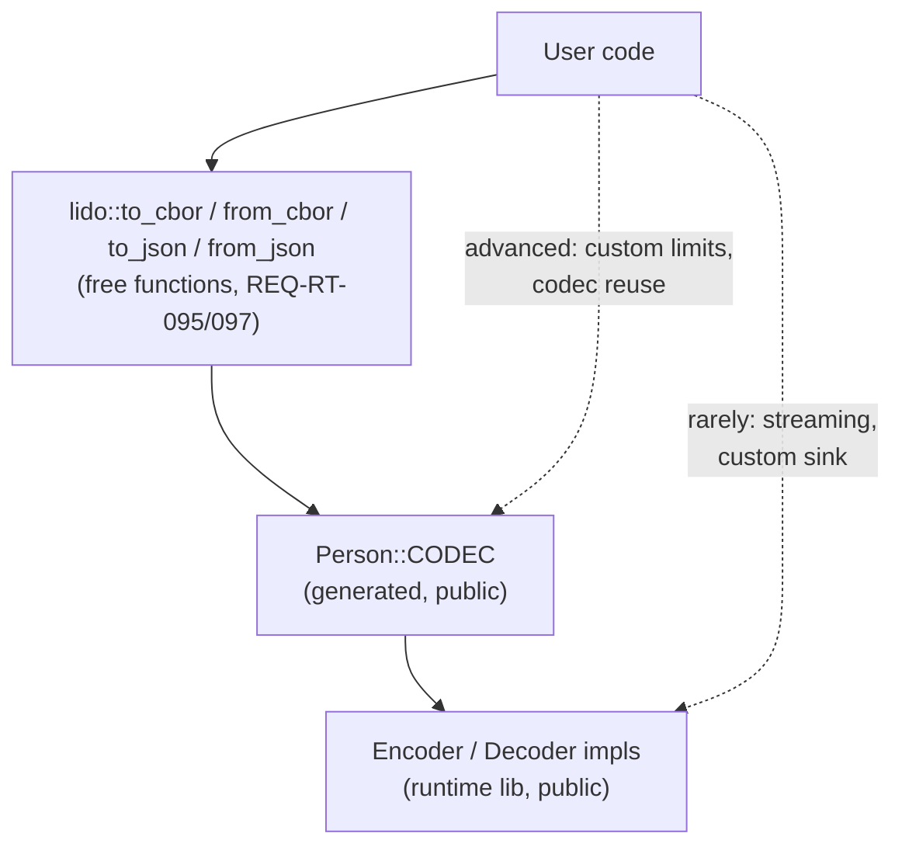
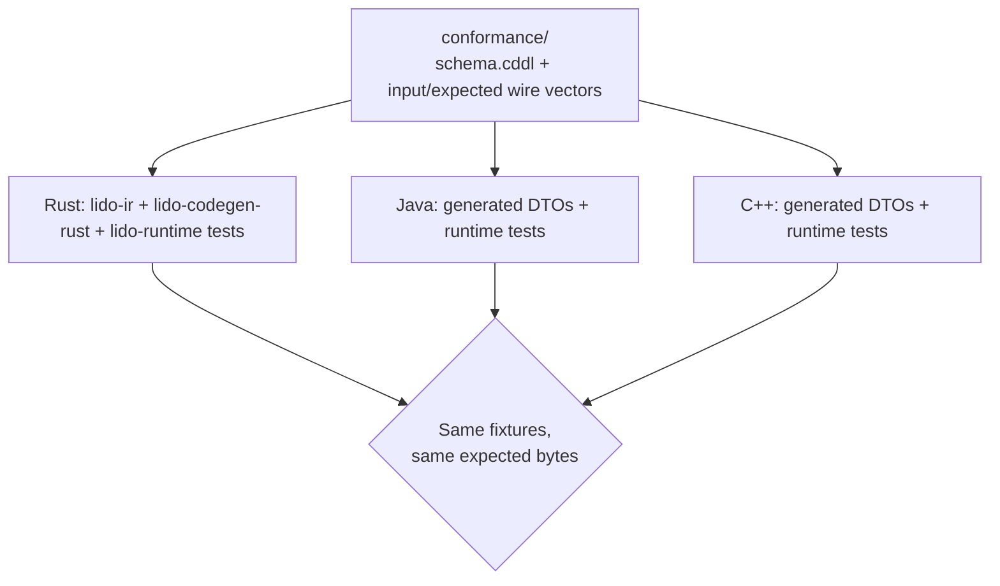

# Lido — Design Document

Status: Draft v0.1

## 0. Relationship to other documents

- `specs.md` defines *what* Lido must do (EARS-format requirements,
  `REQ-*` IDs cited throughout this document).
- `code-style.md` defines the *public* API shape of generated DTOs
  (fluent builders, records, plain structs).
- This document defines the *internal* architecture that satisfies both:
  crate/module boundaries, the compiler pipeline, the IR, and — the part
  neither other document covers — how generated code actually talks to
  CBOR/JSON without embedding encoding logic in the DTO itself.

Diagrams are internal-design sketches, not requirements; where a diagram
or code sketch encodes a real decision, it says so and cites the `REQ-*`
IDs it satisfies. Where something is illustrative only, it's marked as
such.

## 1. System overview



The runtime libraries are **not generated**. They're hand-written,
versioned, and distributed independently per REQ-DIST-010/030/040;
generated code depends on them but Lido never regenerates them. This
split is what REQ-ARCH-050 means by "conforming to a shared conceptual
contract rather than shared source code."

## 2. Workspace layout

Lido is a Rust workspace (REQ-IMPL-010), with the CDDL front end shared
by every backend (REQ-ARCH-010) and each backend isolated in its own
crate (REQ-ARCH-030/040):

```
lido/
├── Cargo.toml                  # workspace root
├── crates/
│   ├── lido-cddl/               # lexer + parser: CDDL text -> AST
│   ├── lido-ir/                 # name resolution, validation, AST -> IR lowering, IR (de)serialization
│   ├── lido-codegen/            # Backend trait, pretty-printer, file-writer helpers
│   ├── lido-codegen-cpp/        # C++ backend
│   ├── lido-codegen-java/       # Java backend
│   ├── lido-codegen-rust/       # Rust backend
│   └── lido-cli/                # `lido` binary — orchestrates the above (REQ-DIST-010)
├── runtime/
│   ├── rust/                    # `lido-runtime` crate (REQ-DIST-010)
│   ├── cpp/                     # headers + minimal sources, CMake package (REQ-DIST-040)
│   └── java/                    # Maven project (REQ-DIST-030)
├── xtask/                       # `xtask` crate — project automation, not published
├── conformance/                 # shared CDDL fixtures + expected wire vectors (REQ-ARCH-060)
└── doc/
    ├── specs.md                 # requirements — document of record
    ├── design.md                # this file — document of record
    ├── code-style.md            # generated-code style — document of record
    ├── decisions.md             # append-only decision log — document of record
    ├── plan.md                  # phase/slice sequencing
    ├── development.md           # process: the loop, gates, context hygiene
    ├── rust-style.md            # Lido's own Rust style (written at Phase 2 kickoff)
    └── slices/                  # per-slice implementation plans — historical, not normative
```



No backend crate depends on another (REQ-ARCH-040) — the diagram has no
edges between `lido-codegen-{cpp,java,rust}`. `lido-ir`'s output type is
the only thing they share.

`xtask/` is project automation — the [cargo-xtask][xtask] pattern — and
is deliberately absent from the diagram above: it is not part of the
compiler pipeline, and no crate under `crates/` or `runtime/` may depend
on it. It is a workspace member so that `cargo test` and `cargo metadata`
cover it, it sets `publish = false`, and it is therefore outside
REQ-DIST-010. It sits at the repository root rather than under `crates/`
for the same reason `runtime/rust` does: `crates/` holds the product, and
`xtask` is not the product. Its first task is the workspace-layout test
that checks this tree against the actual workspace (slice 0.1); the
`cargo xtask <cmd>` alias in `.cargo/config.toml` is added by the first
slice that needs a task invoked outside `cargo test`.

[xtask]: https://github.com/matklad/cargo-xtask

The `doc/` tree lists every document, but only `specs.md`, `design.md`,
`code-style.md`, and `decisions.md` are documents of record. Everything
under `doc/slices/` is a historical implementation plan and is explicitly
not normative (development.md §2.2).

## 3. Compiler pipeline

### 3.1 Parsing (`lido-cddl`)

CDDL text → AST, covering exactly the grammar in specs.md §3 (including
`.default` as the sole admitted control operator, and integer- or
text-keyed struct maps per specs.md §3.1). Errors carry file/line/column
(REQ-CDDL-060). The concrete parsing approach (hand-written
recursive-descent vs. a parser-combinator crate) is not yet decided —
see this document's §8.

### 3.2 Validation & lowering (`lido-ir`)

AST → IR. Ordering matters here: forward and cross-file references mean
the full definition table must exist before references can be resolved,
and cycle classification needs the completed reference graph. So this is
staged, not single-pass:

1. **Collect** all type definitions across the compilation unit into one
   namespace (REQ-CDDL-030), so forward references resolve (REQ-CDDL-020).
2. **Resolve** every named reference, erroring on unresolved names
   (REQ-CDDL-040) and on constructs outside the core subset
   (REQ-CDDL-050).
3. **Classify cycles** over the now-complete reference graph as breakable
   or unbreakable (REQ-CDDL-090/095), marking the breaking edge
   (REQ-CDDL-097).
4. **Lower** to IR: assign each struct field its wire key from the schema
   text/integer key, never from declaration order (REQ-KEY-050,
   REQ-COMPAT-030); assign choice discriminants (REQ-RT-370); order
   struct fields canonically (§4.3); validate numeric ranges and
   range/type consistency.

### 3.3 Intermediate representation



The IR is what REQ-IR-010/020/030 describe; `ir_version` is the field
REQ-IR-050 requires. It serializes to JSON (REQ-IR-040) and is the sole
input to every backend (REQ-ARCH-020).

### 3.4 Backend interface (`lido-codegen`)

Illustrative sketch, not a finalized signature:

```rust
pub trait Backend {
    fn id(&self) -> &'static str;    // "cpp" | "java" | "rust"
    fn generate(
        &self,
        schema: &ir::Schema,
        options: &GenOptions,
    ) -> Result<GeneratedOutput, GenError>;
}

pub struct GeneratedOutput {
    pub files: Vec<GeneratedFile>,   // path (relative), contents
}
```

There is deliberately no `supported_features()` capability-declaration
method: REQ-GEN-120 requires every v1 backend to support the entire core
subset, so such a method would have no v1 caller. It is added when
REQ-EXT-040 is un-deferred, i.e. when a backend that cannot meet
REQ-GEN-120 is first proposed.

Generated files carry their wire metadata inline as literal constants
(REQ-GEN-030); `GeneratedOutput` is source files only, with no separate
metadata artifact.

Adding a language means implementing `Backend` plus a runtime library
satisfying §5's contract — nothing else changes (REQ-ARCH-070,
REQ-EXT-010/020).

### 3.5 Code generation strategy

Output is built as strings via a small internal pretty-printer in
`lido-codegen`, not a template engine (Jinja/Askama/etc.). This keeps
determinism (REQ-GEN-070) a property of the generator's own code rather
than of template-whitespace edge cases, and avoids adding a templating
dependency to the compiler's own dependency graph. Each backend still
shares the pretty-printer's indentation/wrapping helpers, so output
"looks generated" consistently across languages without sharing
language-specific logic.

### 3.6 CLI orchestration (`lido-cli`)



## 4. Wire format & runtime architecture

This is the part that makes REQ-GEN-020 ("no CBOR/JSON logic inside the
DTO type") and REQ-RT-090 ("consumer never hand-writes per-type
encode/decode code") both true at once.

### 4.1 Two-layer generated output

For every IR struct/table/choice type, a backend emits two things:

1. **The DTO** — exactly what `code-style.md` describes: a plain value
   type with no awareness of CBOR or JSON.
2. **A generated codec** — a separate impl block (same file or a
   sibling file; a per-backend choice, not fixed here) that implements
   the runtime library's `Encode`/`Decode`-equivalent interface for
   that DTO, expressed against an abstract encoder/decoder rather than
   against CBOR or JSON directly.

The codec is what REQ-GEN-030 means by "wire metadata … in a form
consumable by the runtime library": wire keys are compiled in as
literal constants/calls in the generated codec, not loaded from a
side-channel metadata blob at runtime. This costs nothing at runtime
and needs no reflection, which matters directly for §9.5's
FreeRTOS-readiness goals.

### 4.2 One codec, two encodings

The runtime library defines an `Encoder`/`Decoder` interface; it ships
two implementations (CBOR, JSON). The *same* generated codec drives
both, which is exactly how REQ-RT-050 (CBOR and JSON represent the same
logical data) is guaranteed structurally rather than by convention —
there is only one encode path per type to get out of sync.

Rust sketch (most concrete, since Rust is both the implementation
language and a target):

```rust
// runtime/rust — hand-written, not generated
pub trait Encoder {
    fn write_map_header(&mut self, len: usize) -> Result<(), EncodeError>;
    fn write_key_text(&mut self, key: &str) -> Result<(), EncodeError>;
    fn write_key_int(&mut self, key: u64) -> Result<(), EncodeError>;
    fn write_u64(&mut self, v: u64) -> Result<(), EncodeError>;
    fn write_str(&mut self, v: &str) -> Result<(), EncodeError>;
    // ... one method per §8.1 primitive type
}

pub trait WireEncode {
    fn encode<E: Encoder>(&self, e: &mut E) -> Result<(), EncodeError>;
}

pub struct CborEncoder<W> { /* ... */ }
pub struct JsonEncoder<W> { /* ... */ }
// each implements Encoder
```

`EncodeError` is a single runtime-library error type rather than an
encoder-associated type, because generated codecs must raise errors the
*encoder* knows nothing about: range violations (REQ-RT-250), a
`float16` value not representable in half precision (REQ-RT-255), and
NaN/±Infinity reaching a JSON encoder (REQ-RT-210). It carries a field
path so those errors can identify the offending field as REQ-RT-060/070
require. `DecodeError` is its counterpart on the read side.

```rust
// crates/lido-codegen-rust output — generated, not hand-written
impl WireEncode for Person {
    fn encode<E: Encoder>(&self, e: &mut E) -> Result<(), EncodeError> {
        // Absent optional fields are omitted, not written as null
        // (specs.md REQ-RT-320), so the map length is the count of
        // fields actually present, computed before the header is
        // written to satisfy the definite-length requirement of
        // REQ-RT-160/340 — not a fixed constant.
        let len = 2 + self.email.is_some() as usize;
        e.write_map_header(len)?;
        // Emitted in canonical key order (REQ-RT-165): keys sort by
        // their *encoded* bytes, so "age" (0x63…) precedes "name"
        // (0x64…) precedes "email" (0x65…) — length-first, NOT
        // alphabetical, and not declaration order.
        e.write_key_text("age")?;   e.write_u64(self.age)?;
        e.write_key_text("name")?;  e.write_str(&self.name)?;
        if let Some(email) = &self.email {
            e.write_key_text("email")?; e.write_str(email)?;
        }
        Ok(())
    }
}
```

C++ and Java follow the same shape with language-appropriate
mechanisms:

- **C++**: `Encoder`/`Decoder` as class templates (compile-time
  polymorphism), not virtual base classes — avoids vtable indirection
  and keeps RTTI out of the picture entirely, which is a stronger fit
  for REQ-RT-120 than runtime polymorphism would be. Errors are
  returned, not thrown, matching the non-throwing path REQ-RT-120
  requires. Note the library is *mostly* header-only but not purely so:
  vendoring a C CBOR library such as `tinycbor` brings compiled sources,
  which is why REQ-DIST-040 says "headers and any minimal accompanying
  source" rather than header-only.
- **Java**: an `Encoder`/`Decoder` interface, with `CborEncoder`/
  `JsonEncoder` implementations in the runtime jar; generated code
  implements a small `Codec<Person>` per type.

### 4.3 Determinism by construction

Backends emit (and match, on decode) struct fields in **canonical
wire-key order**, not declaration order: keys sorted by the bytewise
lexicographic order of their *encoded* form, per REQ-RT-160/165. The
encoded form includes the CBOR head byte, which carries the length, so
this is effectively **length-first, then bytewise** for text keys —
`"age"`, `"name"`, `"email"` — and plain numeric order for unsigned
integer keys. It is emphatically *not* alphabetical; a generator that
sorts field names as strings produces non-conforming CBOR that still
round-trips against itself, so this is the ordering bug most likely to
survive review.

Because the order is fixed at generation time, canonical map ordering
(REQ-RT-160) costs nothing at runtime — no sorting, no buffering of
entries. The same fixed order is reused for JSON output so JSON text is
also byte-stable across runs and languages, even though JSON itself has
no canonical-ordering requirement.

### 4.4 Choice types on the wire

A choice value encodes as a **single-entry map** keyed by the variant's
discriminant (REQ-RT-360/370) — not untagged, and not a CBOR tag:

```rust
// Shape = Circle / Rect  =>  {"Circle": {...}} or {"Rect": {...}}
impl WireEncode for Shape {
    fn encode<E: Encoder>(&self, e: &mut E) -> Result<(), EncodeError> {
        e.write_map_header(1)?;
        match self {
            Shape::Circle(v) => { e.write_key_text("Circle")?; v.encode(e) }
            Shape::Rect(v)   => { e.write_key_text("Rect")?;   v.encode(e) }
        }
    }
}
```

Untagged encoding was rejected because two variants can match the same
input (two structs whose required fields overlap), making decoding
ambiguous in a way the schema cannot detect cheaply; CBOR tags were
rejected because they have no JSON equivalent, which would break the
single-codec-two-encodings property of §4.2.

Note the asymmetry with struct fields: an unknown *struct* key is
skipped for forward compatibility (REQ-COMPAT-020), but an unknown
*discriminant* is a hard error (REQ-RT-380) — there is no value to
construct when no variant matches. Adding a variant is therefore a
breaking change for old readers, as REQ-COMPAT-040 already states.

Enumerations of literals are *not* wrapped; they encode as the literal
value itself (REQ-RT-385), so an enum stays readable as a plain string
in JSON.

### 4.5 Decode: unknown fields, duplicates, limits, defaults



`Decoder::skip_value()` is a required primitive precisely because
REQ-COMPAT-020 needs the ability to discard an unrecognized entry
*without the codec knowing that entry's type* — the whole point of
forward compatibility. This is the one place the runtime interface is
shaped directly by a compatibility requirement rather than by the
encoding format.

`Decoder` implementations own the configurable limits from REQ-RT-270
(max nesting depth) and REQ-RT-290 (max string/collection size);
generated codecs don't see or manage them.

## 4.6 The user-facing surface

§4.1–4.5 describe the machinery; this section covers what a user of the
generated code actually touches. The layering is deliberate — the
plumbing is public for advanced use, but nothing in the common path
requires knowing it exists.



Three levels, each a fallback for the one above:

1. **Free functions** — `lido::to_cbor(&person)?`. One expression, no
   objects to construct. This is the entire API for most users.
2. **The generated codec** — `Person::CODEC`, public so callers can
   apply custom decode limits (§9.4 of specs.md) or reuse a codec in a
   hot loop.
3. **`Encoder`/`Decoder`** — for streaming or writing into a
   caller-supplied buffer, which is also what REQ-RT-150 needs for
   constrained targets.

Error values are the other surface users hit constantly. Per REQ-RT-065
they carry a **path from the DTO root**, expected-vs-found, and an input
offset:

```
DecodeError: order.items[3].price: expected uint, found tstr (byte 147)
```

A bare `"invalid field"` would be near-useless in a nested payload,
which is exactly where decoding fails in practice.

Two further DX affordances are structural rather than incidental:

- **`lido inspect`** (REQ-CLI-100) decodes a payload against a schema
  and prints it with wire keys resolved to field names. This is close to
  mandatory for integer-keyed schemas — `{"1": "abc", "2": 42}` is not
  something anyone should debug by hand.
- **Version-mismatch detection** (REQ-GEN-190): generated code asserts
  the runtime API version it was built against, so a stale runtime is a
  clear build error instead of mysterious wire behavior.

## 4.7 Performance techniques

specs.md §12.1 states the performance *outcomes* (benchmarked,
non-regressing, no steady-state allocation); this section records the
techniques expected to deliver them. These are design guidance, not
requirements — a backend that hits the benchmarks another way is fine.

Most of the win is already structural and should not be traded away:
compiled-in wire keys mean no reflection or metadata lookup
(REQ-GEN-030); canonical field order is fixed at generation time so
canonical CBOR needs no runtime sort (§4.3); map lengths are computed,
not backpatched (REQ-RT-340); and C++ encoders are templates, so the
encode path inlines end to end.

The remaining hot spots are in decode:

- **Key dispatch must not be a linear chain of string comparisons.** A
  naive generator emits `if (key == "a") … else if (key == "b") …`,
  which is O(fields) per field and quadratic over a wide struct — most
  visibly in C++, where each arm is a full `std::string` compare.
  Generate a switch on the key's *length* first, then compare only the
  candidates of that length. Integer-keyed structs get a plain switch,
  which compilers turn into a jump table.
- **Seen-field tracking is a bit set.** Duplicate detection
  (REQ-RT-300) and missing-required detection (REQ-RT-060) both need
  "have I seen this field?". With the field count known at generation
  time this is one integer and a shift/mask per field
  (REQ-PERF-050) — never a `HashSet<String>`, which would allocate per
  decode and hash every key.
- **Reserve once, clamped to remaining input.** REQ-RT-280 permits
  reserving from a length prefix as long as the reservation is clamped
  to what the input could actually supply, turning multi-realloc growth
  into a single allocation for strings and collections.
- **Buffer reuse is exposed, not implicit.** `to_cbor_into(&value,
  &mut buf)` (REQ-RT-098) lets a hot loop encode without allocating,
  while the allocating `to_cbor` stays the documented default (§4.6).

One optimization is *available but deliberately not built yet*: because
Lido peers always emit keys in canonical order (REQ-RT-160), a decoder
could check "is this the next expected key?" before falling back to
general dispatch, making the common case a single comparison. It is
recorded here so it is not rediscovered as novel, but it should be
implemented only if benchmarks show key dispatch actually matters —
adding a second decode path to every generated struct is real complexity
to carry on speculation.

## 5. Conformance testing architecture



One language-neutral fixture set (REQ-ARCH-060) — schema + CBOR/JSON
vectors for representative values, non-canonical inputs (to exercise
REQ-RT-180), and malformed inputs (§9.4) — is consumed by each
language's own test harness. Conformance is defined once; each backend
and runtime library is judged against the same bytes.

## 6. Extensibility checklist (adding a target language)

Per REQ-ARCH-070/REQ-EXT-010/020/030, adding a language means, and only
means:

1. A new `lido-codegen-<lang>` crate implementing `Backend` (§3.4).
2. A new hand-written runtime library implementing the `Encoder`/
   `Decoder` contract (§4.2) for that language.
3. Covering the full core subset (specs.md §3) per REQ-GEN-120, and
   passing the shared conformance suite (§5), before being considered
   supported. There is no partial-support path in v1 — see §3.4.

No change to `lido-cddl` or `lido-ir` is required or permitted for this.

## 7. Key design decisions & rationale

| Decision | Rationale | Related requirements |
|---|---|---|
| Cargo workspace, shared front end / isolated backend crates | One parser/validator/IR shared by all backends; backends can't couple to each other | ARCH-010, 030, 040 |
| Two-layer output: plain DTO + separate generated codec | DTO stays free of encoding logic; runtime library never needs hand-written per-type code | GEN-020, RT-090 |
| One codec generic over an `Encoder`/`Decoder` interface, not duplicated per format | CBOR and JSON output can't drift apart — there's one code path, not two | RT-050 |
| Fields encoded/matched in canonical (length-first bytewise) wire-key order, fixed at generation time | Canonical CBOR map ordering falls out of codegen, no runtime sort or buffering | RT-160, RT-165 |
| Choices as single-entry `{discriminant: value}` maps, not untagged and not CBOR tags | Unambiguous even when variants overlap in shape; works identically in JSON, unlike tags | RT-360, RT-370, RT-380 |
| Single `EncodeError`/`DecodeError` type in the runtime lib, not an encoder-associated error | Codecs must report range, `float16`, and NaN errors the encoder knows nothing about, with a field path | RT-060, RT-210, RT-250, RT-255 |
| Three-level API: free functions → generated codec → `Encoder`/`Decoder` | The 5-minute path is one expression; advanced control stays reachable without complicating it | RT-095, RT-097 |
| Required fields as builder-factory parameters (C++/Java); no Rust builder at all | Missing required fields become compile errors; an additive schema change can't reshape the construction API | GEN-020, COMPAT-040 |
| CDDL comments become doc comments | Schema intent reaches IDE hover and generated docs instead of dying in the `.cddl` file | GEN-180 |
| Lido version stamped in one manifest, not every file | Upgrading Lido doesn't diff every generated file in repos that commit generated code | GEN-080, GEN-195 |
| Length-bucketed key dispatch + bit-set seen-field tracking | Keeps decode linear and allocation-free without affecting the generated API | PERF-040, PERF-050 |
| Buffer-reuse encode variants alongside allocating ones | Hot paths avoid per-call allocation; the one-liner stays the default | RT-098, PERF-040 |
| No zero-copy/borrowed DTOs, no `unsafe`, no SIMD | Each would trade the primary goal (API usability, auditability) for throughput | PERF-060, PERF-070 |
| `Decoder::skip_value()` as a required primitive | Lets old-schema code discard fields it's never heard of | COMPAT-020 |
| Wire keys compiled as literal constants in the codec, not a runtime-loaded table | Zero-cost, no reflection, works with no heap/OS | GEN-030, RT-140 |
| C++ `Encoder`/`Decoder` as templates, not virtual interfaces | No vtables/RTTI; fits header-only distribution and the no-exception path | RT-120, DIST-040 |
| Hand-written pretty-printer instead of a template engine | Determinism is generator-code property, not template-whitespace trivia; no extra compiler dependency | GEN-070 |
| Absent optional fields omit their key; map length computed from fields present, not declared | Smaller payloads; keeps presence (`?`) and value-nullability (`T / null`) independently meaningful; matches REQ-RT-160's definite-length requirement | RT-320, RT-330, RT-340 |

## 8. Open design questions

1. Parser implementation for `lido-cddl`: hand-written recursive-descent
   vs. a parser-combinator/PEG crate. Deferred to implementation start.
2. Whether the generated DTO and its codec live in one file or two, per
   language — a backend-level style choice, not fixed here.
3. Whether `lido-ir` stays one crate as validation logic grows, or splits
   into separate resolution/validation/lowering modules or crates.
4. Exact `GenOptions`/CLI-flag-to-backend-option mapping (namespaces,
   per-language output layout) — sketched in specs.md REQ-CLI-055/057,
   not finalized here.
