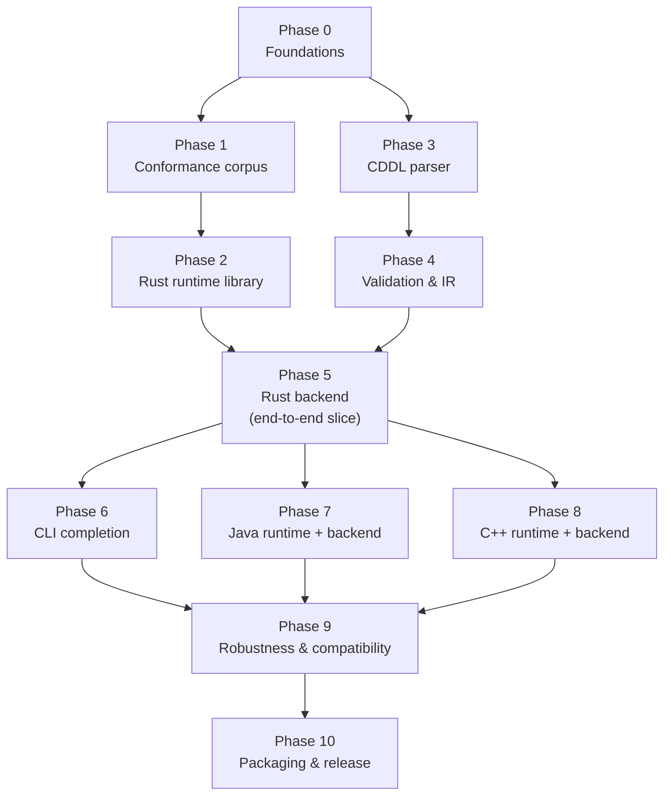

# Lido — Phased Implementation Plan

Status: Draft v0.2

## 0. How to read this plan

- **Slices are the unit of work.** One slice = one branch = one PR = one
  plan-implement-review loop. Each slice carries its own **Definition of
  Done (DoD)** — a concrete, runnable check, not a subjective judgement.
  The process itself is described in `doc/development.md`.
- **Phases are checkpoints, not sprints.** They exist to carry the
  dependency structure, the integration-level DoD, and the points at
  which open questions get closed. They are deliberately uneven: Phase 0
  is two slices, Phase 2 is seven.
- **Phase numbers follow the critical path.** Lower numbers are earlier
  on the longest chain into Phase 5. Phases 3–4 (the compiler front end)
  are independent of Phases 1–2 (the corpus and runtime) and can be
  interleaved; the numbering says which chain to protect from slipping,
  not that 3 waits on 2.
- `REQ-*` IDs refer to `specs.md`; `§n` references without a document
  name refer to `design.md`. Every slice cites the requirements it
  implements, and every test names the requirement it covers.
- **Slice detail is written one to two phases ahead.** Phases 0–5 are
  sliced below. Phases 6–10 remain task lists and are sliced at their
  phase kickoff — planning Phase 9's slices today would be fake
  precision.
- The guiding principle is a **vertical slice first**: get one language
  (Rust) working end-to-end through Phase 5 to validate the architecture
  before replicating it for Java and C++. A defect in the IR or the
  runtime contract is far cheaper to find with one backend than three.

The critical path is **0 → 1 → 2 → 5 → 7/8 → 9 → 10**. The compiler front
end (3 → 4) runs alongside it and is not on that path. Phases 7 and 8 are
independent of each other.

---

## Phase 0 — Foundations

Repository skeleton, process scaffolding, and the CI that every later
slice relies on.

### 0.1 — Repository and workspace skeleton

**Scope.** `git init`; MIT `LICENSE`, `README.md`, `.gitignore`. Cargo
workspace and empty crates per §2: `lido-cddl`, `lido-ir`, `lido-codegen`,
`lido-codegen-{cpp,java,rust}`, `lido-cli`, plus the `runtime/rust`
crate. Pin the toolchain with `rust-toolchain.toml` (2021 edition).
Process scaffolding: `CLAUDE.md`, `doc/decisions.md`,
`doc/slices/README.md`, `.github/pull_request_template.md`.

**Requirements.** REQ-DEP-010, REQ-NFR-030.

**DoD.** A clean clone builds: `cargo build` and `cargo test` succeed on
the empty workspace with the pinned toolchain, and `cargo metadata`
lists every crate named in §2.

### 0.2 — CI and dependency policy

**Scope.** CI running build, `cargo test`, `cargo clippy -- -D warnings`,
and `cargo fmt --check` on Linux, macOS, and Windows. `cargo-deny`
license/advisory gate enforcing the permissive-only policy. Record the
reference CI runner configuration that the compiler-throughput bar will
later be measured against. Branch protection on `main` requiring all
checks.

**Requirements.** REQ-CLI-090, REQ-DEP-020, REQ-NFR-010 (runner spec only).

**DoD.** CI is green on all three platforms. A deliberately added
copyleft dependency fails `cargo deny check` in CI, and the failure is
demonstrated before being reverted. The reference runner specification is
recorded in `doc/decisions.md`.

**Phase DoD:** `main` is protected, CI is green on three platforms for
the empty workspace, and the dependency-license gate has been shown to
fail closed.

---

## Phase 1 — Conformance corpus (independent ground truth)

The shared oracle from REQ-ARCH-060 that all three languages are judged
against. Independent of the compiler front end, and first on the critical
path because every phase after it uses the corpus as its DoD.

*Vector*: one corpus case — a schema, an input value, and the
independently derived expected output (canonical CBOR, JSON, or an
error classification). Test vector in the RFC sense; unrelated to
`std::vector`.

**Critical constraint:** expected vectors MUST NOT be generated by
Lido's own runtime, or the conformance suite degenerates into asserting
that Lido agrees with itself. Vectors are produced and cross-checked
with independent CBOR/JSON implementations. This holds for the life of
the project: the corpus is never edited to make Lido pass.

### 1.1 — Corpus layout and schemas

**Scope.** Define the corpus directory layout and the manifest format
(schema + case name + value + expected CBOR hex + expected JSON), with a
machine-readable manifest schema. Author CDDL schemas covering the full
§3 subset: text- and integer-keyed structs, tables, fixed and homogeneous
arrays, choices, enums, optionals, defaults, ranges, `bstr`, `float16`,
nested and recursive types.

**Requirements.** REQ-ARCH-060; specs.md §3 in full.

**DoD.** The manifest format is documented and validates against its own
schema. A construct-coverage list maps every construct in specs.md §3 to
at least one corpus schema, and a script asserts the mapping is complete.

### 1.2 — Positive vectors and the self-check harness

**Scope.** Author positive vectors for every schema and verify them with
an independent tool (e.g. Python `cbor2` plus a canonical-CBOR checker),
asserting RFC 8949 §4.2 conformance including key order. Build the corpus
self-check script and wire it into CI.

**Requirements.** REQ-ARCH-060, REQ-RT-160, REQ-RT-165.

**DoD.** The self-check re-derives every expected CBOR and JSON vector
with the independent implementation and passes in CI **with zero Lido
code involved**. Mutating any expected byte causes the self-check to fail.

### 1.3 — Negative and non-canonical vectors

**Scope.** Author negative decode vectors: type mismatches, missing
required fields, duplicate keys, truncated input, invalid UTF-8, bad
discriminants, out-of-range values, explicit null on a non-nullable
optional. Author non-canonical but valid inputs that decoders must
accept: indefinite lengths, unsorted keys.

**Requirements.** REQ-RT-300, REQ-RT-310, REQ-RT-315, REQ-RT-380,
REQ-RT-240, REQ-RT-350, REQ-RT-180.

**DoD.** Every negative vector is classified as either *malformed CBOR*
or *well-formed but schema-invalid*, and the self-check confirms the
classification against the independent implementation. Every
non-canonical input is confirmed to be valid CBOR that a conforming
decoder must accept.

### 1.4 — Evolution pairs and the coverage manifest

**Scope.** Author schema-evolution pairs (old/new revisions) for the §9.6
compatibility matrix. Complete the coverage manifest mapping requirements
to cases, and make its completeness a CI check.

**Requirements.** REQ-COMPAT-010/020/060; specs.md §9.1–§9.8.

**DoD.** Every requirement in specs.md §9.1–§9.8 maps to at least one
corpus case in the coverage manifest, and CI fails if a requirement has
no case. Every §9.6 compatibility scenario has an old/new schema pair.

**Phase DoD:** The corpus self-check passes in CI with zero Lido code,
and the coverage manifest shows full requirement coverage across
§9.1–§9.8.

---

## Phase 2 — Rust runtime library

The hand-written `lido-runtime` crate. Built before any code generation
so the contract that generated code targets is proven first — against the
Phase 1 corpus, not against Lido itself.

### 2.1 — The runtime contract

**Scope.** `Encoder`/`Decoder` traits and the `WireEncode`/`WireDecode`
interface per §4.2. `EncodeError`/`DecodeError` carrying root-relative
field paths, expected-vs-found, and input offsets.

**Requirements.** REQ-RT-050, REQ-RT-060, REQ-RT-065, REQ-RT-090.

**DoD.** The traits compile and are documented with compiling examples.
Error types carry path, expected, found, and offset, asserted by unit
tests. A trivial in-memory mock encoder/decoder pair round-trips a
hand-built value, proving the contract is implementable without CBOR.

### 2.2 — CBOR encoder

**Scope.** `CborEncoder` producing canonical output: definite lengths,
shortest-form heads, shortest round-tripping floats.

**Requirements.** REQ-RT-160, REQ-RT-165.

**DoD.** Byte-for-byte agreement with the Phase 1 positive vectors for
every primitive and container form in the corpus, driven directly from
the manifest rather than from hand-copied bytes.

### 2.3 — CBOR decoder

**Scope.** `CborDecoder`, including `skip_value()`, duplicate-key
detection, and acceptance of non-canonical input.

**Requirements.** REQ-COMPAT-020, REQ-RT-180, REQ-RT-300.

**DoD.** Decodes every Phase 1 positive vector; accepts every
non-canonical input from slice 1.3; rejects every malformed-CBOR negative
vector with the expected error variant and input offset. `skip_value()`
and duplicate-key detection each have dedicated tests.

### 2.4 — JSON encoder and decoder

**Scope.** `JsonEncoder`/`JsonDecoder` with the §9.2 rules: base64url
`bstr`, NaN/∞ rejection, big-integer string form, integer-keyed maps as
decimal member names.

**Requirements.** specs.md §9.2 in full.

**DoD.** Every Phase 1 JSON vector matches exactly. Each §9.2 rule has a
test named for the requirement it covers, including the rejection cases.

*Split candidate: if the diff exceeds one comfortable review, split into
encoder and decoder slices at kickoff.*

### 2.5 — Decode limits and allocation discipline

**Scope.** Configurable nesting-depth and string/collection bounds,
bounded pre-allocation, clamped single-allocation reads, and buffer-reuse
encode entry points.

**Requirements.** REQ-RT-270, REQ-RT-280, REQ-RT-290, REQ-RT-098.

**DoD.** Each limit is enforced with a named test that supplies input
exceeding it and asserts a specific error rather than an abort. A
counting allocator shows the buffer-reuse encode path performing zero
allocations on repeat calls, and shows read allocation bounded by the
declared limit rather than by the length header.

### 2.6 — Public API surface and hand-written codecs

**Scope.** Free-function convenience layer — `to_cbor`/`from_cbor`/
`to_json`/`from_json` — plus the runtime API version constant. Hand-write
codecs for the corpus types and exercise them against the Phase 1
vectors.

**Requirements.** REQ-RT-095, REQ-RT-097, REQ-GEN-190 (constant only).

**DoD.** The hand-written codecs pass **every** Phase 1 CBOR and JSON
vector, positive and negative. This is the proof that the runtime
contract is correct and complete before any generator exists.

### 2.7 — `no_std` build

**Scope.** `no_std` + `alloc` build with an optional `std` feature, and a
CI job building for a `no_std` target.

**Requirements.** REQ-RT-110.

**DoD.** The crate builds for a `no_std` target in CI, the job is a
required check, and default-feature and `std`-feature builds both remain
green.

**Phase DoD:** Hand-written codecs pass every Phase 1 vector, positive
and negative, and the crate builds for a `no_std` target in CI. The
runtime contract is proven independently of the code generator.

---

## Phase 3 — CDDL parser (text → AST)

Front half of the compiler. No semantics yet: this phase only decides
whether input *is* the grammar of specs.md §3. Independent of Phases 1–2.

### 3.1 — Parsing approach and lexer

**Scope.** Decide hand-written recursive descent vs. a parser-combinator
crate and record the decision — this closes design.md §8 open question 1.
Implement the lexer: tokens, comments and whitespace per RFC 8610 §2,
with byte-offset spans.

**Requirements.** REQ-CDDL-060 (spans).

**DoD.** The decision is recorded in `doc/decisions.md` with alternatives
and rationale. The lexer tokenizes every schema in the Phase 1 corpus
without error, and every token's span is asserted to point at the correct
source bytes.

### 3.2 — AST types

**Scope.** AST types covering every §3 construct: type definitions,
struct types with text and integer keys, table types, arrays, primitives,
choices, enums, ranges, `?`/`*` occurrences, `.default`.

**Requirements.** specs.md §3, §3.1.

**DoD.** Every §3 construct has a representation, checked against the
construct-coverage list from slice 1.1. A hand-built AST value for at
least one corpus schema round-trips through a `Debug` snapshot.

### 3.3 — Parser

**Scope.** Parser producing the AST, including multi-file input treated
as one compilation unit.

**Requirements.** REQ-CDDL-030.

**DoD.** Every schema in the Phase 1 corpus parses to a snapshot-stable
AST. A multi-file input parses into a single unit whose contents match
the equivalent concatenated single file.

### 3.4 — Diagnostics and the rejection corpus

**Scope.** Diagnostics carrying file, line, column and "expected X" for
syntax errors, plus distinct unsupported-construct errors. A rejection
corpus asserting exact error spans.

**Requirements.** REQ-CDDL-050, REQ-CDDL-060.

**DoD.** Every schema in the rejection corpus fails with the expected
message and byte span. Out-of-subset CDDL — generics, `.cbor`, socket
`~` — is rejected with a clear unsupported-construct error rather than a
generic syntax error, asserted per construct.

**Phase DoD:** The Phase 1 corpus parses to snapshot-stable ASTs and the
rejection corpus fails with exact, useful diagnostics.

---

## Phase 4 — Validation & IR

Where the schema becomes semantically meaningful and all wire-format
decisions get frozen into data.

### 4.1 — IR data model and name resolution

**Scope.** IR data model per §3.3: `Schema`, `TypeDef`, `StructType`,
`TableType`, `ChoiceType`/`Variant`, `Field`, `WireKey`, `ir_version`.
Stages 1–2 of §3.2: collect definitions across the compilation unit and
resolve all references, including forward and cross-file references.

**Requirements.** REQ-CDDL-020, REQ-CDDL-030, REQ-CDDL-040.

**DoD.** Every corpus schema resolves fully, including at least one
forward reference and one cross-file reference. An unresolved name errors
with the offending span rather than panicking or resolving to a
placeholder.

### 4.2 — Cycle classification

**Scope.** Stage 3 of §3.2: cycle detection over the completed reference
graph, classification as breakable or unbreakable, and marking of the
breaking edge.

**Requirements.** REQ-CDDL-090, REQ-CDDL-095, REQ-CDDL-097.

**DoD.** A directly recursive corpus type classifies as breakable with
its breaking edge marked; a mutually recursive unbreakable case errors
with both participating type names. Classification is tested on the
graph directly, not only through end-to-end lowering.

### 4.3 — Lowering: wire keys, discriminants, canonical order

**Scope.** Stage 4 of §3.2: assign each struct field its wire key from
the schema text or integer key, never from declaration order; reject
mixed key types within a struct; assign choice discriminants; compute and
store canonical field order — bytewise over *encoded* keys, length-first.

**Requirements.** REQ-KEY-010, REQ-KEY-020, REQ-KEY-050, REQ-COMPAT-030,
REQ-RT-370, REQ-RT-165.

**DoD.** The order comparator has dedicated unit tests run directly
against known CBOR key encodings, proving `"age" < "name" < "email"` —
**an alphabetical implementation must fail them.** Reordering fields in a
schema source file produces byte-identical IR. A struct mixing text and
integer keys is rejected.

### 4.4 — Constraint validation and IR serialization

**Scope.** Validate numeric ranges, `.default` literal/type agreement,
and enum literal uniqueness. IR JSON serialization with a version field
and version rejection.

**Requirements.** REQ-IR-040, REQ-IR-050; specs.md §9.3.

**DoD.** Each of the three validation classes has a named rejection test
with the expected span. IR JSON carries `ir_version`, and an IR document
with an unknown version is rejected rather than partially parsed.

### 4.5 — IR golden files

**Scope.** Golden-file tests covering schema → serialized IR for every
§3 construct.

**Requirements.** REQ-ARCH-020, specs.md §7 in full.

**DoD.** Every corpus schema lowers to a byte-identical golden IR JSON
file. The construct-coverage list from slice 1.1 maps every §3 construct
to at least one golden file.

**Phase DoD:** `lido-ir` turns every corpus schema into a golden-matched
IR JSON file. The compiler front end is complete for the §3 subset, and
every wire-format decision is now frozen in data rather than in code.

---

## Phase 5 — Rust backend + minimal CLI (first end-to-end slice)

The architecture's first real test: generated code replacing the
hand-written codecs from slice 2.6. **This phase is the go/no-go
checkpoint** — any IR or runtime-contract rework should happen here,
before it must be done three times.

### 5.1 — Backend interface and pretty-printer

**Scope.** `Backend` trait and `GeneratedOutput` in `lido-codegen` per
§3.4; the shared hand-written pretty-printer per §3.5.

**Requirements.** REQ-ARCH-030, REQ-EXT-010, REQ-GEN-070.

**DoD.** The `Backend` trait compiles with a stub implementation. The
pretty-printer produces stable indentation and wrapping, unit-tested
against fixed inputs, with no dependence on hash iteration order.

### 5.2 — Rust DTO generation

**Scope.** Rust DTO generation per `code-style.md`: public-field structs,
derives, `Option<T>`/`Vec<T>`/`BTreeMap<K,V>`, enums for choices, `Box` at
cycle-breaking edges.

**Requirements.** REQ-GEN-020, specs.md §8.1, §8.2.

**DoD.** Generated DTOs for every corpus schema compile. The type mapping
matches specs.md §8.1 for every construct, asserted by snapshot. A
recursive type generates a `Box` exactly at the edge marked in slice 4.2.

### 5.3 — Rust codec generation

**Scope.** Generated codecs: canonical field order, absent optionals
omitted with a computed map length, choices as single-entry wrapper maps.

**Requirements.** REQ-RT-320, REQ-RT-330, REQ-RT-340, REQ-RT-360.

**DoD.** Generated codecs for the corpus types produce byte-identical
CBOR to the hand-written codecs from slice 2.6 on every positive vector,
and produce the same errors on every negative vector.

### 5.4 — Minimal CLI

**Scope.** Minimal CLI: parse → validate → generate → write, enough to
drive the pipeline end to end.

**Requirements.** REQ-CLI-010, REQ-CLI-020 (single-target subset).

**DoD.** `lido --lang rust <schema> -o <dir>` runs the full pipeline and
writes files. A parse or validation error from any stage surfaces with
file, line, and column and a non-zero exit code.

### 5.5 — Generation hygiene

**Scope.** Identifier mangling and collision detection; `@generated`
markers; `rustfmt`-conformant output; the single version manifest; CDDL
comment → doc comment passthrough; the runtime version assertion.

**Requirements.** REQ-GEN-080, REQ-GEN-090, REQ-GEN-095, REQ-GEN-180,
REQ-GEN-185, REQ-GEN-190, REQ-GEN-195.

**DoD.** A schema containing Rust keywords and casing collisions
generates compiling code or a clear collision error. Generated output is
unchanged by `rustfmt`. The Lido version appears in exactly one manifest
file and in no generated source file. A runtime version mismatch fails to
compile.

### 5.6 — End-to-end conformance harness

**Scope.** Test harness that generates from the corpus schemas, compiles
the output, and runs it against the Phase 1 vectors. Determinism test.

**Requirements.** REQ-GEN-070, REQ-ARCH-060.

**DoD.** Generated Rust compiles and passes **every** Phase 1 CBOR and
JSON vector, positive and negative. Generating twice produces
byte-identical output. The hand-written codecs from slice 2.6 are deleted
as redundant.

**Phase DoD:** `lido --lang rust` produces code that compiles and passes
the entire Phase 1 corpus, and the hand-written codecs from 2.6 are gone.
This is the architecture go/no-go: review the IR shape and the runtime
contract here, deliberately, before Phases 7 and 8 replicate them.

---

## Phase 6 — CLI completion

Everything in specs.md §10 that the Phase 5 minimal CLI skipped. Sliced
at phase kickoff.

| # | Task | Size |
|---|---|---|
| 6.1 | Full argument surface: multi-target selection, recursive directory input, per-language namespace flags (REQ-CLI-020/030/055) | M |
| 6.2 | Output layout: per-language subdirectories always, Java package-mirroring path rules (REQ-CLI-057) | M |
| 6.3 | All-or-nothing write semantics (REQ-CLI-065) and `--dry-run` (REQ-CLI-080) | M |
| 6.4 | Error reporting: collect and print all diagnostics, correct exit codes, success summary (REQ-CLI-060/070) | S |
| 6.5 | Rich diagnostic rendering — source line plus column-span indicator (REQ-CLI-063), via a permissively licensed diagnostics crate | M |
| 6.6 | `lido inspect`: decode a payload against a schema, resolve wire keys to field names, partial output on failure (REQ-CLI-100/110) | M |
| 6.7 | `--serde`/`--jackson`-style ecosystem interop flag plumbed to backends (REQ-CLI-058) | S |
| 6.8 | End-to-end CLI acceptance tests, including a forced-failure case asserting the output directory is untouched, and snapshot tests of diagnostic output | M |

**Phase DoD:** CLI acceptance tests pass on Linux, macOS, and Windows,
including the failure-atomicity case. `lido inspect` renders an
integer-keyed payload with field names resolved, and diagnostic
snapshots are reviewed for readability, not just correctness.

---

## Phase 7 — Java runtime library + backend

First replication of the vertical slice. Independent of Phase 8. Sliced
at phase kickoff.

| # | Task | Size |
|---|---|---|
| 7.1 | Maven project skeleton, Java 17 baseline, CI integration | S |
| 7.2 | Java runtime: `Encoder`/`Decoder` interfaces, CBOR and JSON implementations, error types with field paths | L |
| 7.3 | Java DTO generation: `record`s with fluent `Builder`s per `code-style.md`, `sealed interface` choices, immutable `List`/`Map` | L |
| 7.4 | Explicit value-based `equals`/`hashCode` where `byte[]` fields defeat record equality (REQ-GEN-160) | S |
| 7.5 | Java codec generation mirroring the Rust codec's wire behavior | M |
| 7.6 | Javadoc passthrough, `@generated` markers, formatter-conformant output, optional Jackson annotations (REQ-GEN-180/185/200) | M |
| 7.7 | Java conformance harness running the Phase 1 corpus | M |

**Phase DoD:** Generated Java passes the identical Phase 1 corpus,
producing byte-identical CBOR to the Rust implementation (REQ-RT-170).

---

## Phase 8 — C++ runtime library + backend

The hardest backend, because of the §9.5 portability constraints. Sliced
at phase kickoff.

| # | Task | Size |
|---|---|---|
| 8.1 | CMake project, C++17 baseline, `find_package`/`FetchContent` support (REQ-DIST-040), CI integration | M |
| 8.2 | C++ runtime: `Encoder`/`Decoder` as class templates (§4.2), CBOR and JSON implementations, result-type errors — no exceptions, no RTTI (REQ-RT-120) | L |
| 8.3 | C++ DTO generation: fluent `Builder`s, `std::optional`/`std::vector`/`std::map`/`std::variant`, member-wise equality at the C++17 baseline | L |
| 8.4 | C++ codec generation mirroring Rust/Java wire behavior | M |
| 8.5 | Doxygen comment passthrough, `@generated` markers, `clang-format`-conformant output (REQ-GEN-180/185) | S |
| 8.6 | C++ conformance harness running the Phase 1 corpus | M |
| 8.7 | CI job building the runtime and generated code with `-fno-exceptions -fno-rtti` to enforce REQ-RT-120 mechanically | M |

**Phase DoD:** Generated C++ passes the identical Phase 1 corpus with
byte-identical CBOR output, and the whole thing compiles clean under
`-fno-exceptions -fno-rtti`.

---

## Phase 9 — Robustness & compatibility

Cross-cutting guarantees that only become testable once all three
languages exist. Sliced at phase kickoff.

| # | Task | Size |
|---|---|---|
| 9.1 | Differential fuzzing: random schema-valid values → encode in all three languages → assert byte-identical CBOR (REQ-RT-170) | L |
| 9.2 | Decoder fuzzing (`cargo-fuzz` for Rust, equivalents elsewhere) against malformed input, asserting errors rather than crashes/hangs/OOM (§9.4) | L |
| 9.3 | Round-trip property tests: `decode(encode(x)) == x` for all three languages | M |
| 9.4 | Compatibility matrix from corpus slice 1.4: old-writer/new-reader and new-writer/old-reader, across all nine language pairs (REQ-COMPAT-010/020/060) | L |
| 9.5 | Choose and document default decode limits, closing specs.md §16 open question 5 | S |
| 9.6 | Compiler throughput check against REQ-NFR-010 on the Phase 0 reference runner | S |
| 9.7 | Benchmark suite across all three languages and both encodings, covering flat/wide/nested/collection/bstr-heavy payloads (REQ-PERF-010) | L |
| 9.8 | Comparison benchmarks against `serde`, Jackson, and `nlohmann/json` (REQ-PERF-020) | M |
| 9.9 | CI baseline tracking with a regression threshold (REQ-PERF-030); profile and close any gap traced to key dispatch or per-field allocation (§4.7) | M |

**Phase DoD:** Fuzzers run clean for a sustained CI budget with no crashes
or hangs; the full compatibility matrix passes; default limits are
documented; benchmarks run in CI against a recorded baseline, and
comparison numbers against the native libraries exist and are
reviewed — whatever they show.

---

## Phase 10 — Packaging & release

Sliced at phase kickoff.

| # | Task | Size |
|---|---|---|
| 10.1 | Settle artifact naming — crate names, Maven `groupId`/`artifactId`, C++ namespace/include path (specs.md §16 open question 1) | S |
| 10.2 | Publish CLI and runtime crates to crates.io (REQ-DIST-010) | S |
| 10.3 | Release automation for prebuilt CLI binaries across platforms/architectures (REQ-DIST-020) | M |
| 10.4 | Maven Central publication with signing (REQ-DIST-030) | M |
| 10.5 | C++ source archive with CMake package config attached to tagged releases (REQ-DIST-040) | M |
| 10.6 | User documentation: getting started, CDDL subset reference, per-language guides, published benchmark comparisons (REQ-PERF-020), and the REQ-COMPAT-025 read-modify-write data-loss warning | L |
| 10.7 | Version policy across the CLI and the three runtime libraries | S |

**Phase DoD:** A tagged release publishes all artifacts, and a fresh
project on each of the three languages can consume them following only
the public documentation.

---

## Deferred beyond this plan

Tracked so they don't silently reappear as scope:

- Build-system plugins — Maven/Gradle, Cargo `build.rs`, CMake
  (specs.md §2.2).
- FreeRTOS as a *validated* target, and the allocation-model decision
  (specs.md §16 open question 4). Phases 2 and 8 keep the door open by
  enforcing `no_std` and `-fno-exceptions` builds in CI, but no RTOS
  hardware is exercised.
- Partial-backend support declaration (REQ-EXT-040, deferred).
- Unknown-field preservation on round-trip (REQ-COMPAT-025).
- CDDL beyond the §3 core subset — generics, control operators other
  than `.default`, socket/plug extensions.
- Java `uint` representation above 2^63−1 (specs.md §16 open
  question 6) — revisit if a real schema needs it.

---

## Appendix — renumbering from v0.1

v0.2 renumbered phases so that lower numbers sit on the critical path,
and replaced task tables with slice tables for Phases 0–5. Phases 5–10
kept their numbers. Mapping for anyone holding notes against v0.1:

| v0.1 | v0.2 | Old tasks → new slices |
|---|---|---|
| Phase 1 — CDDL parser | **Phase 3** | 1.1+1.2 → 3.1 · 1.3 → 3.2 · 1.4 → 3.3 · 1.5+1.6 → 3.4 |
| Phase 2 — Validation & IR | **Phase 4** | 2.1+2.2 → 4.1 · 2.3 → 4.2 · 2.4+2.5 → 4.3 · 2.6+2.7 → 4.4 · 2.8 → 4.5 |
| Phase 3 — Conformance corpus | **Phase 1** | 3.1+3.2 → 1.1 · 3.3+3.7 → 1.2 · 3.4+3.5 → 1.3 · 3.6 → 1.4 |
| Phase 4 — Rust runtime | **Phase 2** | 4.1 → 2.1 · 4.2 → 2.2 · 4.3 → 2.3 · 4.4 → 2.4 · 4.5+4.8 → 2.5 · 4.1b+4.7 → 2.6 · 4.6 → 2.7 |
| Phases 0, 5–10 | unchanged | Phase 0 tasks 0.1–0.3 → slice 0.1, 0.4–0.6 → slice 0.2; Phase 5 tasks 5.1–5.7 → slices 5.1–5.6 |
